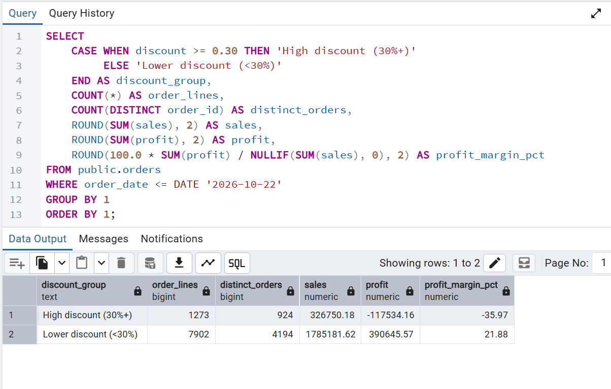
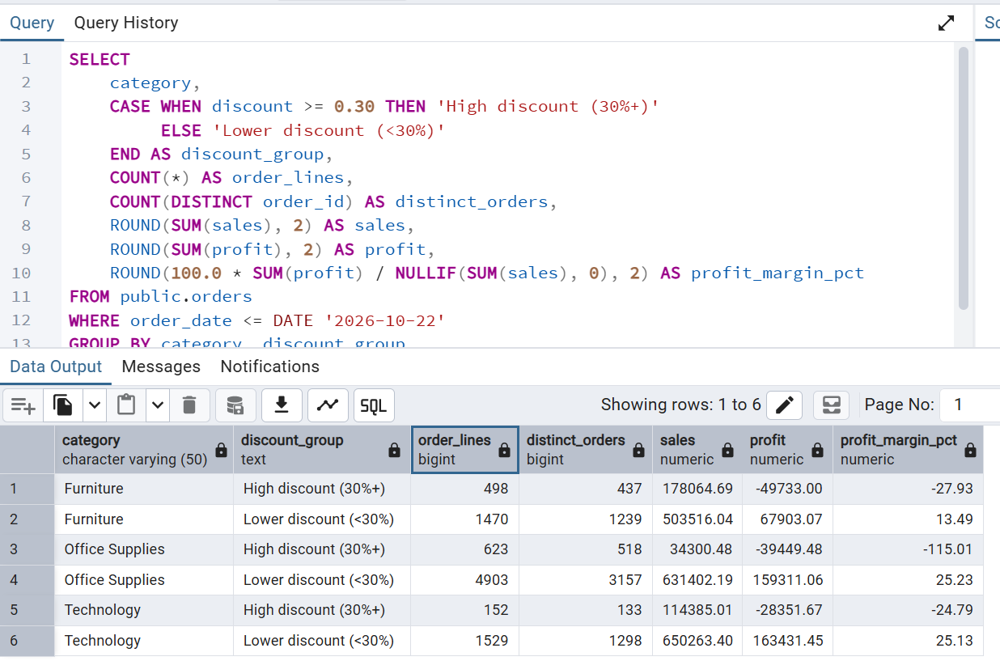
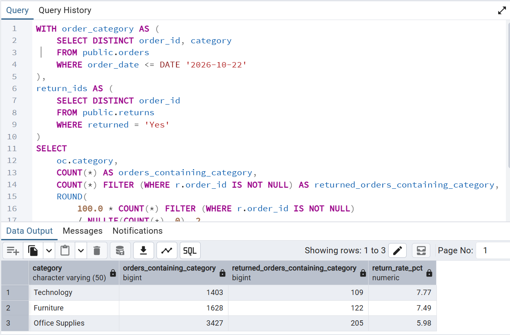
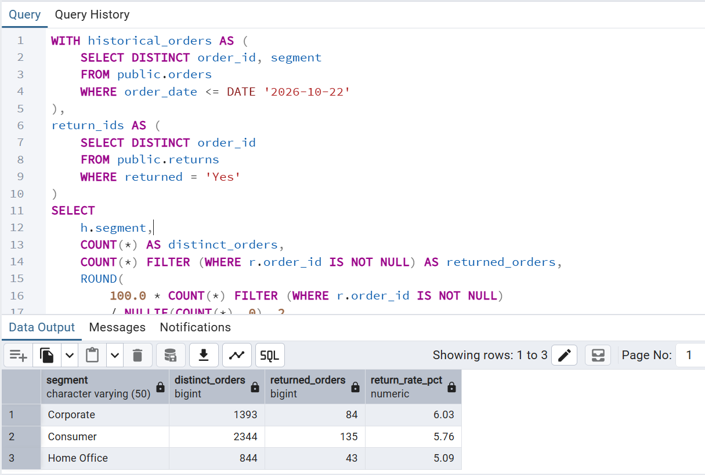
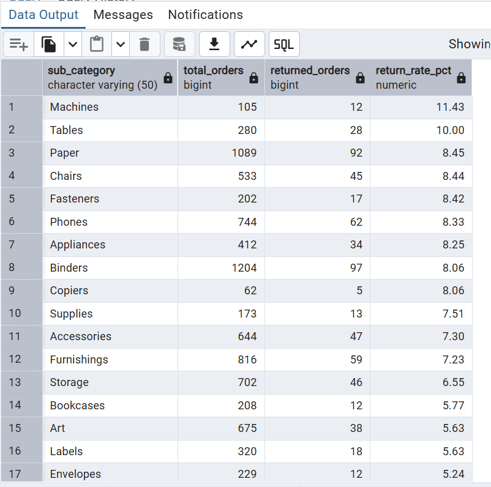

# PostgreSQL Superstore Sales and Profitability Analysis

## Project overview

This project uses PostgreSQL to examine sales, profitability, discount patterns, and recorded order returns in a Superstore-style transactional dataset. The analysis is designed to demonstrate SQL data validation, aggregation, joins, date filtering, profitability metrics, and business interpretation.

## Executive Summary

This project analyses retail sales, profitability, discounting and product returns using PostgreSQL. The objective was to identify the factors associated with business performance and highlight areas where management attention could improve profitability.

The historical analysis covers **9,175 order-line records across 4,581 distinct orders**, from 3 January 2023 to 22 October 2026. Future-dated records were excluded to avoid treating future transactions as historical performance.

### Key business findings

**1. Overall financial performance**

- Total sales: **$2,111,931.81**
- Total profit: **$273,111.42**
- Overall profit margin: **12.93%**

**2. Discounting presents a significant profitability risk**

Orders with discounts of 30% or higher generated $326,750.18 in sales but recorded a loss of $117,534.16, equivalent to a negative profit margin of **-35.97%**.

By comparison, transactions with discounts below 30% generated $390,645.57 in profit, with a margin of **21.88%**.

This indicates a strong association between high discount levels and poor profitability in the analysed data. It does not, on its own, establish that discounts caused the losses.

**3. Returns vary across product categories**

Technology had the highest category-level return rate at **7.77%**, followed by Furniture at **7.49%** and Office Supplies at **5.98%**.

At subcategory level, Machines recorded the highest return rate at **11.43%**, followed by Tables at **10.00%**.

**4. Customer segments show relatively similar return rates**

Corporate customers recorded a return rate of **6.03%**, Consumer customers 5.76%, and Home Office customers 5.09%.

### Business recommendations

Based on these findings, the following actions are worth considering:

- **Review discount policies:** Introduce clearer approval controls for discounts of 30% or higher, supported by product-level profitability checks.
- **Protect product margins:** Investigate products and subcategories generating losses under heavy discounting before continuing or expanding promotional offers.
- **Investigate product returns:** Examine the reasons behind higher return rates for Machines, Tables and Technology products. Review product quality, descriptions, fulfilment and customer expectations.
- **Monitor performance regularly:** Track sales, profit margins, discount levels and return rates by category and subcategory to identify emerging risks.

### Overall conclusion

The analysis demonstrates that strong sales performance does not necessarily translate into strong profitability. Discount management and product-level return monitoring are important areas for improving retail business performance.

The findings are based on the available dataset and should be treated as analytical indicators rather than proof of causation.

## Business questions

- What are the overall sales, profit, and profit margin?
- How do results vary by region, category, subcategory, customer segment, and month?
- Which subcategories and products warrant further profitability review?
- How are high discounts associated with recorded profit?
- What share of historical orders are listed in the returns table, and how does that vary by segment and product category?

## Data and scope

The analysis uses two PostgreSQL tables:

- `public.orders`: order-line data, including dates, customer and product attributes, sales, quantity, discount, and profit.
- `public.returns`: order IDs listed as returned and a return status.

The primary historical cutoff is **22 October 2026, inclusive**. Queries filter on `order_date <= DATE '2026-10-22'`. Records with later order dates are excluded from historical performance analysis because they are future-dated relative to the stated cutoff.

### Historical dataset summary

| Metric | Result |
|---|---:|
| Historical order lines | 9,175 |
| Historical distinct orders | 4,581 |
| Historical sales | $2,111,931.81 |
| Historical profit | $273,111.42 |
| Historical profit margin | 12.93% |
| Historical order-date range | 2023-01-03 to 2026-10-22 |
| Future-dated order lines excluded | 1,019 |
| Future-dated distinct orders excluded | 530 |

Profit margin is calculated as total profit divided by total sales. Monetary values are rounded for display.

## Repository structure

- `01_data_quality.sql` — row counts, ID uniqueness, missing/invalid values, date consistency, potential duplicates, and returns validation.
- `02_sales_profitability.sql` — overall performance and breakdowns by region, category, subcategory, segment, month, and product.
- `03_returns_analysis.sql` — overall order-level return rate and return incidence by segment, category, and subcategory.
- `04_discount_analysis.sql` — profitability by discount group, category, subcategory, and product/discount combination, plus duplicate sensitivity analysis.

## Key findings

### 1. Overall performance

The historical dataset contains 9,175 order lines across 4,581 distinct orders, generating $2.11 million in sales and $273.1 thousand in recorded profit. The overall profit margin is approximately 12.93%.

### 2. Discounts and profitability

The historical high-discount group (30% or more) contains 1,273 order lines across 924 distinct orders, with $326,750.18 in sales and a recorded loss of $117,534.16 (a -35.97% margin). The lower-discount group (below 30%) contains 7,902 order lines across 4,194 distinct orders, with $1,785,181.62 in sales and $390,645.57 in profit (a 21.88% margin).

The same negative high-discount pattern appears in Furniture, Office Supplies, and Technology in the reviewed results. This is an association in the dataset, not proof that discounting alone caused the losses. Product mix, costs, pricing rules, and other factors may contribute. A practical next step is to review discount authorization and contribution margins at the product level rather than apply a blanket cap without further analysis.

### 3. Recorded returns

The returns table contains 296 distinct returned order IDs, all of which match an order in the orders table. Within the historical cutoff, 262 of 4,581 distinct orders are listed as returned, an order-level rate of 5.72%.

Return rates differ by segment: Corporate 6.03%, Consumer 5.76%, and Home Office 5.09%. At category level, Technology has a 7.77% return incidence rate, Furniture 7.49%, and Office Supplies 5.98%. Machines has the highest subcategory rate in the reviewed results (11.43%, 12 returned orders out of 105 orders containing Machines); Tables follows at 10.00% (28 out of 280).

Category and subcategory denominators can overlap because a single order can contain multiple categories or subcategories. The returns table flags returned orders, not necessarily returned individual product lines. The absence of an order from the returns table does not prove that no return occurred.

### 4. Data quality and potential duplicates

All 10,194 source rows have non-null and unique `row_id` values. Basic checks found no missing values in the tested order ID, order date, sales, profit, discount, or quantity fields; no negative sales; no discounts outside the 0-to-1 range; and no nonpositive quantities. No missing ship dates or ship dates earlier than order dates were found.

Two historical row pairs have identical values across all fields except `row_id`. They are treated as **potential duplicates**, not confirmed errors. Together, the extra copies account for approximately $380.49 in sales and $23.36 in profit. The source rows are retained for the primary analysis, with a sensitivity query provided in `04_discount_analysis.sql`. Source verification is needed before removing either record.

## Selected SQL Results

The following PostgreSQL outputs provide evidence of the analysis and illustrate the key findings.

### Discount analysis

**Overall profitability by discount group**

**Profitability by category and discount group**

### Returns analysis

**Recorded return rates by product category**

**Recorded return rates by customer segment**

**Recorded return rates by product subcategory**

## Methodology and limitations

- Historical analyses consistently use `order_date <= DATE '2026-10-22'`.
- Orders are counted with `COUNT(DISTINCT order_id)` where an order-level count is required; the underlying `orders` table is at order-line level.
- Profit margin is `SUM(profit) / SUM(sales)`, not the average of line-level margins.
- Returns are joined at order level using distinct return order IDs to avoid multiplying order-line totals.
- Discount groupings are descriptive. The 30% threshold is used to compare observed groups and is not a universal policy recommendation.
- Results describe recorded values in the dataset and do not establish causation.
- The potential duplicate rows are retained until verified against the source.
- The dataset's `profit` field is treated as the recorded profit measure; the project does not independently validate how source costs, refunds, or return adjustments were calculated.

## How to run

1. Load the dataset into PostgreSQL and confirm the tables are named `public.orders` and `public.returns`.
2. Open each `.sql` file in pgAdmin or another PostgreSQL client.
3. Run `01_data_quality.sql` first and review its results.
4. Run the sales, returns, and discount analysis files.
5. Export selected result tables or create charts for a portfolio presentation if desired.

## Skills demonstrated

- PostgreSQL querying
- Data-quality checks and duplicate detection
- Date filtering and historical scoping
- Aggregations and conditional aggregation
- Joins and common table expressions (CTEs)
- Window functions
- Profit-margin calculations
- Business interpretation with explicit limitations
